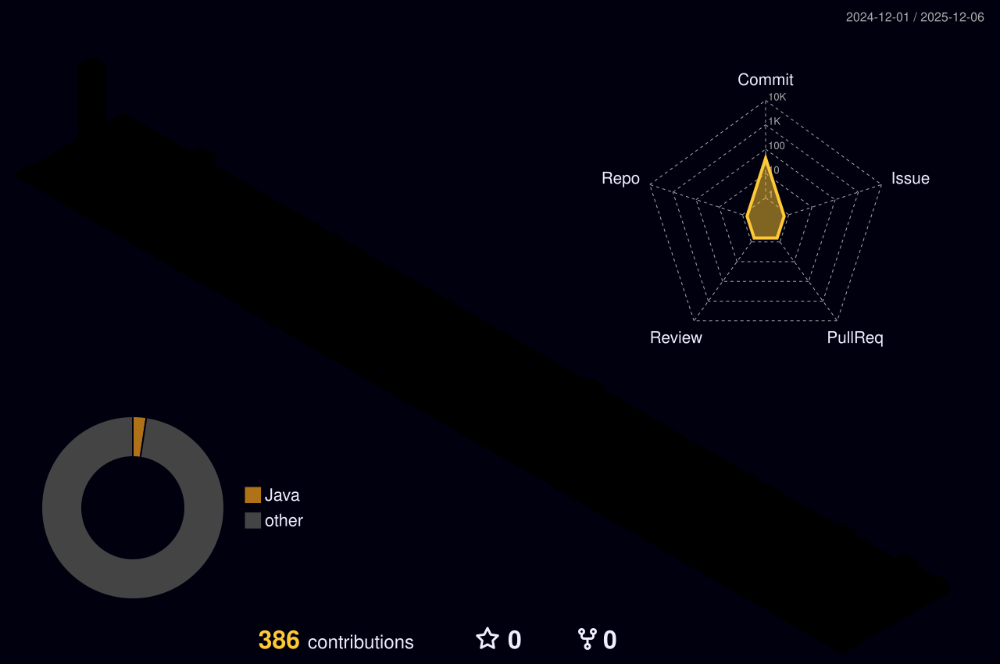

<!-- =========================================================
     GITHUB PROFILE README | KIM DAEYOUNG (@kim-1210)
     Style: Midnight Blue / Cyan / Minimal Robotics Portfolio
     ========================================================= -->

<!-- HERO -->

  

  

    <strong>AI Convergence Robotics · M.S. Student at Inje University</strong> 
    B.S. in Computer Science
  

  
  
  

    

  

<!-- INTRO -->
## 01 / About Me

I am an AI and robotics researcher interested in **connecting perception, learning, and robot control**.
I work on making robots understand their environment, learn useful behaviors, and perform reliable actions in the real world.

- **Research interests:** Reinforcement Learning, Imitation Learning, Robot Manipulation, Computer Vision
- **Robotics interests:** ROS 2, RGB-D Perception, Motion Planning, Sim-to-Real
- **Currently exploring:** Learning-based manipulation and perception-aware robot systems

<!-- FEATURE CARDS -->
## 02 / Research & Projects

<table>
  <tr>
    <td width="50%" valign="top">
      <h3>01 · Learning for Manipulation</h3>
      
Using PPO-generated robot trajectories as demonstrations for Diffusion Policy-based manipulation.

      
<code>Reinforcement Learning</code> <code>Imitation Learning</code> <code>Diffusion Policy</code>

    </td>
    <td width="50%" valign="top">
      <h3>02 · RGB-D Robot Vision</h3>
      
Combining object detection, segmentation, depth estimation, and calibration for robotic grasping.

      
<code>OpenCV</code> <code>RGB-D</code> <code>ROS 2</code>

    </td>
  </tr>
  <tr>
    <td width="50%" valign="top">
      <h3>03 · Simulation & Robot Learning</h3>
      
Training and evaluating robot behaviors in simulation, with an emphasis on reproducible experiments.

      
<code>Isaac Sim</code> <code>Isaac Lab</code> <code>PyTorch</code>

    </td>
    <td width="50%" valign="top">
      <h3>04 · Mobile Robot Perception</h3>
      
Exploring LiDAR and depth-camera sensing for mapping, localization, and navigation.

      
<code>LiDAR</code> <code>SLAM</code> <code>ROS 2</code>

    </td>
  </tr>
</table>

  <a href="https://github.com/kim-1210?tab=repositories"><strong>Explore repositories →</strong></a>

<!-- STACK -->
## 03 / Tech Stack

  
    
  
  
  
  

<!-- ACTIVITY -->
## 04 / GitHub Activity

  
  
   
  

<!-- 3D CONTRIBUTION GRAPH: requires the existing profile-3d-contrib SVG -->

  
<strong>3D Contribution Graph</strong>

   
  

    
  

<!-- PROBLEM SOLVING -->
## 05 / Problem Solving

  

<!-- CONTACT -->
## 06 / Let's Connect

  
Interested in robotics, embodied AI, and practical systems that work beyond simulation.

  
  
  

<!-- FOOTER -->

